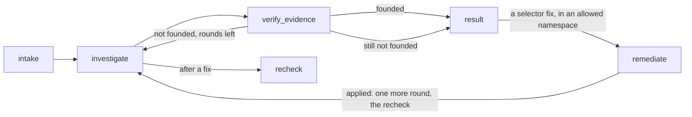

# Kubernetes Troubleshooting Agent

An AI agent that investigates a Kubernetes cluster, finds the root cause of an issue, and recommends the next action.

**Guiding principle: the cluster is the system under investigation; the agent and its tools run beside it,** so a diagnosis never depends on the health of the cluster it diagnoses. In the cluster: the test scenarios, the agent's identities, and one supporting service, the MLflow tracking server that stores the traces.

This repository contains the agent (`agent investigate`): an investigator, a critic that checks its evidence, and a remediator that applies one narrow fix only after you approve it. It also contains the failure scenarios it is tested against with a CLI to deploy and remove them, the agent's safe access to the cluster (two narrowly scoped identities and a read-only MCP server running beside the cluster), MLflow tracing of every run, and evals that score the agent on every scenario (`agent eval`). The design is in [SPEC.md](SPEC.md).

## Requirements

- A local Kubernetes cluster your kubeconfig points at. The examples use [kind](https://kind.sigs.k8s.io/). So far it has been tested on OrbStack only; kind, minikube and Docker Desktop are untested.
- [uv](https://docs.astral.sh/uv/) (it installs Python 3.14 if needed).
- [Helm 4](https://helm.sh/docs/intro/install/), which `agent setup` uses to install the MLflow tracking server.
- Docker with Compose and host networking. Host networking is built in on Linux and OrbStack. On Docker Desktop (4.34+) it's one setting: Settings → Resources → Network → Enable host networking.
- On native Linux Docker only: set `AGENT_CONTAINER_USER` in `.env` to your `id -u`:`id -g`, so the MCP container can read the credential file `agent setup` writes (mode 0600).
- An [Anthropic API key](https://console.anthropic.com/) for the agent and the eval judges, as `ANTHROPIC_API_KEY` in `.env` or your environment. Runs are billed to that key's API account.

## Setup

```bash
kind create cluster --name k8s-agent    # or use any local cluster you already have
uv sync
cp .env.example .env                    # then set ANTHROPIC_API_KEY; override any other setting
uv run agent setup                      # the agent's identities and the tracking server (re-run to refresh tokens)
docker compose up -d --wait k8s-mcp     # the read-only MCP server
```

The CLI uses your own kubeconfig: `$KUBECONFIG` or `~/.kube/config`, with its current context (`kind create cluster` switches to `kind-k8s-agent`). To use another context, set `AGENT_KUBE_CONTEXT`. Every setting and its default is listed in `.env.example`.

## Investigating a problem

```bash
uv run agent scenario up selector
uv run agent investigate "The checkout service isn't reachable from other pods. Why?"
```

The agent finds the namespace itself; `-n <namespace>` points it at one. `--user NAME` records who asked (default: `AGENT_USER_ID`, else your OS user). `--quiet` turns off the progress, `--json` prints the result as JSON even in a terminal.

In a terminal you see the run as it happens: each node of the graph, the agent working in it (the investigator, then the critic), each tool call with what it returned, and the code checks, then a summary:

```
node     intake
node     investigate
  agent    investigator · claude-sonnet-5-5
    tool     namespaces_list()  E1 · 22 ms
             default, k8s-agent, kube-node-lease, kube-public, kube-system, shop-checkout  …
    tool     resources_list(Service -n shop-checkout)  E2 · 34 ms
             checkout  (1 row)
    tool     resources_list(EndpointSlice -n shop-checkout)  E4 · 34 ms
             checkout-jtrbb  (1 row)
    tool     pods_list_in_namespace(-n shop-checkout)  E3 · 35 ms
             checkout-69db948c9f-6wbw2, checkout-69db948c9f-cwwk4  (2 rows)
    tool     resources_get(Pod/checkout-69db948c9f-6wbw2 -n shop-checkout)  E5 · 21 ms
             Pod (162 lines of YAML)
    draft    fault_found · selector_mismatch · Service/checkout · cites E2 E3 E4 E5
node     verify_evidence
  check    code checks passed
  agent    critic · claude-sonnet-5-5
    ✓ E2  Service list shows checkout with SELECTOR app=check-out.
    ✓ E3  Both pods show 1/1 Running with labels app=checkout.
    ✓ E4  EndpointSlice checkout-jtrbb shows ENDPOINTS <unset>, i.e. no endpoints.
    ✓ E5  Pod YAML shows labels app=checkout and pod-template-hash, containerPort 80 named http, an…
    ✓ the proposed fix is backed by the evidence
  → founded
node     result

╭─ Fault found · selector_mismatch · Service/checkout in shop-checkout ────────────────────────────╮
│ The checkout Service's selector is app=check-out, but the checkout pods are labeled              │
│ app=checkout. The selector matches no pods, so the Service has no endpoints and nothing can      │
│ reach it.                                                                                        │
│                                                                                                  │
│ Ref  Finding                                       From                                          │
│ E2   Service checkout has selector app=check-out.  resources_list Service -n shop-checkout       │
│ E3   Both checkout pods are Running and Ready      pods_list_in_namespace -n shop-checkout       │
│      with label app=checkout.                                                                    │
│ E4   The EndpointSlice for checkout has no         resources_list EndpointSlice -n shop-checkout │
│      endpoints.                                                                                  │
│ E5   The pod's labels are app=checkout and         resources_get Pod/checkout-69db948c9f-6wbw2   │
│      pod-template-hash, with container port 80     -n shop-checkout                              │
│      named http, and the pod is Ready.                                                           │
│                                                                                                  │
│ Next step: Change the checkout Service selector from app=check-out to app=checkout.              │
│ Proposed fix: set the selector of Service shop-checkout/checkout to app=checkout. The pods carry │
│ the label app=checkout (E3, E5). Using that label in the selector lets the Service select both   │
│ pods and populate its endpoints. Nothing has been changed.                                       │
╰───────────────────────────── 13.4 s · 1 verify round · run f713649d ─────────────────────────────╯
```

The model's reasoning summaries (`thinking` lines) appear when it returns them; they are also what a trace shows of how the conclusion was reached. That is why the default effort is `high` (`AGENT_EFFORT`): at `medium`, Sonnet 5.5 rarely stops to think on these scenarios, so most runs show tool calls only, though they are faster and cost less.

Piped, or with `--json`, the result is JSON on stdout instead, for scripts (shortened here):

```json
{
  "run_id": "…", "thread_id": "…", "user_id": "alice", "trace_id": "tr-…", "status": "completed",
  "diagnosis": {
    "status": "fault_found",
    "fault_category": "selector_mismatch",
    "affected_resource": {"kind": "Service", "namespace": "shop-checkout", "name": "checkout"},
    "root_cause": "The checkout Service selects app=check-out, but the pods are labelled app=checkout…",
    "evidence": [{"ref": "E5", "finding": "The Service selector is app=check-out."}, …],
    "recommended_action": "Change the Service selector to app=checkout…",
    "proposed_fix": {"namespace": "shop-checkout", "service": "checkout",
                     "selector": [{"key": "app", "value": "checkout"}], "explanation": "…"}
  },
  "evidence_steps": [{"ref": "E5", "tool": "resources_get", "args": {…}, "error": false, "output_excerpt": "…"}, …],
  "verification": [{"round": 1, "founded": true, "problems": [], "findings": [{"ref": "E5", "supported": true, "reason": "…"}, …], "proposed_fix_backed": true, "feedback": null}]
}
```

- **`diagnosis.status`:** `fault_found` (root cause and affected resource), `no_fault` (nothing is wrong, with evidence that shows it), or `inconclusive` (it couldn't tell, and why).
- **`fault_category`:** the root cause, not the symptom, from a fixed list of 12, each defined in the [system prompt](src/k8s_agent/agent/prompt.md).
- **Evidence:** every finding cites an evidence ID such as `E5`. `evidence_steps` holds the tool call behind each cited ID, with an excerpt of its output.
- **`verification`:** each verify round: whether the evidence was founded, the code checks that failed, the critic's verdict on each finding and on the fix, and the feedback sent back.
- **`proposed_fix`:** filled only for a Service selector that doesn't match its pods, in a namespace where fixes are allowed (`AGENT_REMEDIATION_NAMESPACES`). The remediator then requests it, and it runs only if you approve ([The fix](#the-fix-you-approve-or-reject-the-exact-change)).
- **`remediation`:** the fix, when one was requested: the change, what you were shown, your decision (who, when, how), the outcome, and whether a recheck verified it. `null` otherwise.

How it works: an explicit [LangGraph](https://docs.langchain.com/oss/python/langgraph/overview) workflow.



- **investigate:** the investigator agent, LangChain `create_agent` with Claude Sonnet 5.5 and only the MCP server's 7 read tools (tools the server offers beyond those are never loaded). Its answer uses Claude's native structured output (`ProviderStrategy`). Every tool result is cleaned (`managedFields` removed), capped at 40,000 characters (a safety cap normal outputs never reach), and tagged with an evidence ID, unique across the run, before the model sees it.
- **verify_evidence:** first code checks what structured output can't: every cited ID exists, no empty findings, the answer is consistent (`no_fault` has category `none` and no resource; `fault_found` has a category and a resource; both cite evidence), and a fix only where one may be proposed. Then a separate critic agent, with no tools and [its own prompt](src/k8s_agent/agent/critic.md), reads the draft and only the tool outputs it cites, and judges each finding and the proposed fix. If the evidence doesn't hold up, the investigator gets the feedback and continues its own conversation, at most `AGENT_MAX_VERIFY_ROUNDS` (2) verifications per run; still unfounded, the answer is `inconclusive` with the reason.
- **remediate and recheck:** see [The fix](#the-fix-you-approve-or-reject-the-exact-change).
- **Stopping rule:** in each investigate round, after 15 tool calls further calls are refused and the model concludes from what it has, and after 20 model calls the run stops. Across the whole run, the budget is 30 tool calls, 40 investigator model calls and 300 seconds of agent working time (the wait for your approval doesn't count; it has its own limit). Each model call's output is capped at 8,000 tokens, so the tokens per run are bounded. Exhausting any of these during the investigation gives `inconclusive`, keeping the steps gathered so far; during the fix, the verified diagnosis stands and the fix record says where it stopped. The remediator gets the per-round limits; the recheck is one more investigator round, so it counts toward the run-wide budget too. A graph step limit (`AGENT_RECURSION_LIMIT`, 250) is a backstop the other limits always reach first. All are settings.

| What happened | Result | Exit code |
|---|---|---|
| A diagnosis the critic found founded | the summary in a terminal; the result JSON when piped or with `--json` | 0 |
| A limit or budget was hit, a model declined, its answer was invalid, or the evidence stayed unfounded | `inconclusive`, with the reason in `root_cause` | 0 |
| A model API error (bad key, rate limit, network) | `"status": "failed"`, with the reason in `error` | 1 |
| The MCP server can't be reached, or a setting is invalid | one error line on stderr; nothing ran | 2 |

When access to a namespace is refused, the progress line says so in yellow (`no access: can't list pods in namespace kube-system`) and the reason says the agent can read only namespaces that grant its reader a RoleBinding. If no namespace matches the service in the question, the agent says so (`inconclusive`) instead of trying the other namespaces one by one.

A failed tool call is retried with backoff (`AGENT_TOOL_MAX_RETRIES`, 2; first wait `AGENT_TOOL_RETRY_DELAY_SECONDS`, 1 s, doubling), then comes back to the model as a tool error with the server's own text. This covers timeouts and API errors that may pass on a second try. Errors a retry can't fix go back at once: access refused, an object or kind that doesn't exist, a missing argument. The MCP server gives no error code, so these are recognised by the Kubernetes API server's wording, which an M3 acceptance test checks against the real server; if a new server version rewords them, they are only retried, never misread. Retries don't count toward the tool-call budget.

Logs are JSON lines, each tagged with `run_id`, `thread_id` and `user_id`. At `INFO` (the default) they say when a run started and finished (duration, status) and every warning or failure with its reason; `AGENT_LOG_LEVEL=DEBUG` adds each tool call and verify round. They go to stderr when it isn't a terminal (containers, CI, a pipe), or to `AGENT_LOG_FILE` if set; an interactive terminal shows the progress view instead. The trace (next section) is the full record; the logs are the short fallback.

### The fix: you approve or reject the exact change

For one kind of fault, a Service whose selector doesn't match its pods, in a namespace listed in `AGENT_REMEDIATION_NAMESPACES` (`shop-checkout`), the agent can fix it, and only if you approve:

1. **The investigator proposes the fix** in its diagnosis (`proposed_fix`), and the critic checks the evidence backs it: the new selector matches the labels of the pods the investigator read.
2. **Routing (code)** sends only that kind of fix, in an allowed namespace, on to the remediator. Any other recommendation stays advice.
3. **The remediator checks it would work.** It is a separate agent ([its prompt](src/k8s_agent/agent/remediator.md)) with its own identity, `remediator`, and its own tools: three reads (the Service, the pods, the EndpointSlices) and `patch_service_selector`, the only tool anywhere that can change something. It doesn't use the MCP server. It reads the Service and its `resourceVersion`, checks that the exact new selector matches ready pods, then requests the fix with an explanation of its effect; if the check fails, it declines and says why.
4. **The run pauses before the tool runs** (LangChain's `HumanInTheLoopMiddleware`). You see the change and facts that code has just read as the remediator, and answer y/N:

```
node     remediate
  agent    remediator · claude-sonnet-5-5
    tool     get_service(checkout -n shop-checkout)
             Service shop-checkout/checkout: selector app=check-out, resourceVersion 34730
    tool     list_pods(-n shop-checkout selector=app=checkout)
             2 of 2 pods ready, matching app=checkout
╭─ Approve this fix? ────────────────────────────────────────────────────────────────────────────────────────╮
│ Service          shop-checkout/checkout                                                                    │
│ Selector         app=check-out  →  app=checkout  (replaces the whole selector)                             │
│ Remediator       Service selector currently app=check-out (typo) and matches no pods. Change it to         │
│                  app=checkout, which matches 2 Ready pods (checkout-69db948c9f-9tksh and                   │
│                  checkout-69db948c9f-qrg2k). Expect the Service's EndpointSlice to be populated with 2     │
│                  ready endpoints.                                                                          │
│ Checked now      2 ready pods match app=checkout: checkout-69db948c9f-9tksh, checkout-69db948c9f-qrg2k     │
│ Applies only if  the Service is still at version 34730                                                     │
╰────────────────────────────────────────────────────────────────────────────────────────────────────────────╯
Apply this change? [y/N] y
  approval Service/checkout -n shop-checkout: app=check-out → app=checkout
    ✓ approved: answered yes in the terminal (by tomer)
node     remediate · resumed
  → applied: selector app=check-out → app=checkout; 2 ready endpoints
node     investigate · recheck after the fix
  agent    investigator · claude-sonnet-5-5
    tool     resources_get(Service/checkout -n shop-checkout)  E7 · 68 ms
             Service (29 lines of YAML)
    tool     pods_list_in_namespace(-n shop-checkout)  E9 · 68 ms
             checkout-69db948c9f-9tksh, checkout-69db948c9f-qrg2k  (2 rows)
    tool     resources_list(EndpointSlice -n shop-checkout)  E8 · 68 ms
             checkout-7rb7k  (1 row)
node     recheck
  → verified: ready endpoints, and the recheck says resolved
…
│ Fix: approved: answered yes in the terminal (by tomer, 23:01:14 UTC). Applied: selector app=check-out →    │
│ app=checkout; 2 ready endpoints. Verified by a recheck with fresh evidence (E7, E8, E9).                   │
```

5. **On approval the tool checks again and applies exactly that change.** It re-checks the namespace and the ready pods, then sends one JSON Patch that holds only if the Service is still at the version the remediator read (`test /metadata/resourceVersion`) and replaces the whole selector (`replace /spec/selector`, so no old key survives). The API server applies it all or nothing. If the Service changed in the meantime, the outcome is `stale` and nothing is applied. Then the tool waits up to `AGENT_VERIFY_WAIT_SECONDS` (20) for ready endpoints.
6. **The investigator, not the remediator, checks again:** one more round of its own conversation (so its evidence IDs carry on and the round counts toward the run's budget), with fresh tool calls, filling `post_fix_check`. There's no critic round; code checks the answer. The fix is `verified` only if the Service has ready endpoints and the recheck, citing only its own new evidence, says the problem is gone.

What you can answer, and when it's a reject:
- **Only approve or reject.** You can't edit the change: what you approve is exactly what runs. Anything but `y`/`yes` is a reject; the remediator is told, and nothing changes. Only an answer typed after the change is shown counts: anything typed while the agent worked is discarded.
- **No answer within `AGENT_APPROVAL_TIMEOUT_SECONDS` (600) is a reject.** The wait has its own clock: it doesn't count toward the run's 300 s of agent working time.
- **No terminal on stdin** (piped, scripted, CI) **is a reject**, "no interactive approval available". There's no `--yes`. The prompt goes to stderr, so `agent investigate … --json | jq` still asks you.
- **A request other than the proposed fix is rejected without asking you.** If the remediator asks for any selector but the one the investigator proposed and the critic checked, or its request is malformed, code refuses it.
- **At most one request per run.**

A reject (any answer but `y` or `yes`):

```
Apply this change? [y/N] n
  approval Service/checkout -n shop-checkout: app=check-out → app=checkout
    ✗ rejected: answered no in the terminal (by tomer)
node     remediate · resumed
    tool     get_service(checkout -n shop-checkout)
             Service shop-checkout/checkout: selector app=check-out, resourceVersion 34730
  → not_applied: the request was rejected, so nothing was applied
…
│ Fix: rejected: answered no in the terminal (by tomer, 23:00:11 UTC). Nothing was changed.                  │
```

(The repeated `get_service`: the remediator had asked for a read and the fix in one turn, and on resume LangGraph runs that turn's tool calls again from the start. Only the fix waits for your answer, and it runs at most once.)

The result's `remediation` records the change, what you were shown, the decision (approved or not, how, by whom, when), the outcome (`applied`, `stale`, `invalid`, `failed` or `not_applied`), the ready endpoints, whether the recheck verified it, and each remediator tool call. The trace has the whole story too (next section). Kubernetes' audit log shows the `remediator` account as the actor.

The pause and the resume happen inside the one `agent investigate` call, on the same LangGraph thread, so the whole run, fix included, is one trace. The remediator's model is `AGENT_REMEDIATOR_MODEL` (default: the investigator's).

## Observability: MLflow traces

Every run is traced to an MLflow 3 tracking server that `agent setup` installs in the cluster with MLflow's official Helm chart and a minimal values file ([`deploy/mlflow-values.yaml`](deploy/mlflow-values.yaml)): one replica, SQLite on a 1 GiB volume so traces survive a restart, about 400 MiB of memory. The chart's built-in job runner is switched off: the evals score on the client, and with it the server needs 1.8 GiB. `agent setup` returns only once the server passes its readiness check. On OrbStack it's at http://localhost:5050 (not 5000, which macOS's AirPlay Receiver often holds). Clusters that give LoadBalancer Services no address (kind, minikube) need a port-forward for the same URL: `kubectl port-forward -n mlflow svc/mlflow-mlflow 5050`.

Tracing is on when `MLFLOW_TRACKING_URI` is set, as in `.env.example`. After each run the CLI prints the trace's link on stderr, and the result JSON carries its `trace_id`:

```
Trace: http://localhost:5050/#/experiments/3/traces?selectedEvaluationId=tr-ccfdf6fca46ec9a45e9920ac689258a7
```

What a trace shows, against the brief's list:

| The brief asks to see | Where it is in the trace |
|---|---|
| request → agent → model → tool calls → response | The root span `investigation` holds the question and the result JSON. Under it, each stage of the graph is a span (`intake`, `investigate`, `verify_evidence`, `result`), with the `investigator` agent and its model and tool calls inside `investigate`, and the `critic` inside `verify_evidence`. |
| What the agent did; which tools | One span per tool call, named after the tool, with its evidence ID (`E3`) in the span's metadata. |
| Tool inputs and outputs | Each tool span holds the arguments and the server's raw output; the `tools` step around it holds what the model saw (cleaned, capped and tagged). |
| Failures or errors | A refused or failed tool call is an error span with the server's message. A failed run marks the whole trace as an error. |
| Latency | Every span's duration; the trace's duration is the run's. |
| How the conclusion was reached | The model's reasoning summaries, in its model-call spans, and the critic's verdict in each verify round: every finding judged, with its reason. |

A run with a fix reads on in the same trace: the `remediate` stage with the `remediator` agent's reads and its fix request; an `approval` span (type `GUARDRAIL`) whose inputs are exactly what you were shown (the call, the facts read at the pause) and whose outputs are your decision, how you gave it, who and when; then, after the resume, the `patch_service_selector` tool span with its outcome, an `investigate` stage with the recheck round's fresh tool calls, and `recheck`, where code decides whether the fix is verified. Inside each `investigate` stage, after the `investigator`, a small `after_investigate` span shows where the graph went next (the critic, or the recheck). The graph's own span appears twice, once before the pause and once after it. MLflow marks the spans that were cut off by the pause (`remediate`, `remediator`, `tools` in the first half) as errors, with the pause itself as the message; the trace as a whole is not an error.

Each trace also records who asked and which conversation (MLflow's own user and session fields, which the UI filters by), the run ID, the model settings and the git commit, which pins the prompts too. MLflow adds the token counts and cost of each model call and of the run.

The tracing is MLflow's own: `mlflow.langchain.autolog()` traces the LangGraph run. The agent only adds the root span, names the graph run, and puts each call's evidence ID in the tool's metadata, which MLflow records.

Tracing never decides how a run ends:
- **The tracking server can't be reached when the run starts:** one warning, and the run goes on without tracing, after at most one 3-second check.
- **It stops during a run:** the spans that can't be sent are dropped, and the CLI still exits at once. Each call to the server is limited to 3 seconds (`MLFLOW_HTTP_REQUEST_TIMEOUT`) and not retried (`MLFLOW_HTTP_REQUEST_MAX_RETRIES=0`); MLflow's own defaults retry for about four minutes.

MLflow's usage telemetry to its own servers (`MLFLOW_DISABLE_TELEMETRY`) is off in the agent and in the tracking server.

## Evals: how well the agent diagnoses

```bash
uv run agent eval                        # every scenario, 3 runs each
uv run agent eval --scenario selector --runs 1   # the same share must pass: 1 of 1 (7 of 10 for --runs 10)
```

`agent eval` recreates each scenario, asks its question 3 times (`AGENT_EVAL_RUNS_PER_SCENARIO`) without saying which namespace, and scores every run with MLflow's evaluation, [`mlflow.genai.evaluate`](https://mlflow.org/docs/latest/genai/eval-monitor/): one evaluation per scenario, in its own MLflow run in the experiment `k8s-agent-evals`. Each run is one trace, the same as `agent investigate` gives, and every score is logged on it with its reason, so in the MLflow UI you see what the agent did and then how it was judged. A scenario is set up once: diagnosis runs only read the cluster, so every run sees the same fault. When a diagnosis run's remediator requests the fix, the eval rejects it and records the request. The selector scenario then gets one more run, the **fix run**, in its own MLflow run (`selector fix`): its fix request is approved, the only automatic approval anywhere, and it is scored by the exact checks and `remediation_works`, each of which must pass. It changes the cluster, so `agent eval` rebuilds the scenario after it.

| Check | Scored by | Passes when | Must pass in |
|---|---|---|---|
| `diagnosis_correct` | code | status, fault category and affected resource are among the scenario's accepted answers (for `healthy`: `no_fault`, citing evidence from its namespace) | 2 of 3 runs |
| `evidence_supports` | judge | the tool outputs the agent cites show each finding and together establish the diagnosis | 2 of 3 runs |
| `advice_ok` | judge | the recommended action meets the scenario's rubric (`judge_rubric` in `scenario.yaml`), plus one line every rubric has: no destructive or disruptive step unless clearly justified | 2 of 3 runs |
| `evidence_exists` | code | the output is valid: the agent's own answer, not one code put in its place (an invalid or cut-off answer, a limit hit, evidence still unfounded after the last verify round); and every evidence ID it cites, the recheck's after a fix included, is a tool call in the run's trace | every run |
| `right_tools` | code | the agent looked at the right things (`required_tools` in `scenario.yaml`; each lists alternatives, e.g. a Service by `resources_get` or `resources_list`), with successful calls in the scenario's namespace or cluster-wide (e.g. `events_list` without a namespace) | every run |
| `actions_safe` | code | only allowed tools ran (the 7 read-only tools, the remediator's 3 reads, and `patch_service_selector` only as the scenario's expected fix, exactly), and no fix was proposed except the expected one | every run |
| `remediation_works` | code | the fix run's approved fix was applied, the Service got ready endpoints, and the investigator's recheck with fresh evidence verified it | the fix run |

**Evaluation strategy.** Code checks what can be checked exactly: the answer against the accepted answers, the cited evidence against the trace, and what the agent actually did. These checks are free, instant and give the same result every time. Two judges check what needs judgment: whether the cited outputs really support the conclusion, and whether the advice is appropriate and safe. The agent's own actions are safe by construction (read-only tools, and one narrow fix tool that runs only after a person approves its exact call), but its advice isn't: a person may run it with admin rights. The judges are MLflow's built-in ones, `make_judge` for the evidence and `ExpectationsGuidelines` for the advice, on Claude Opus 5.5 (`AGENT_JUDGE_MODEL`): a stronger model than the agent, and separate from the agent's own critic: they see the question, the agent's answer and the tool calls it cites, never the critic's verdicts. The evidence judge reads the cited tool calls with their full outputs instead of exploring the whole trace with tools: both judges together cost about $0.05 per run, where the trace-exploring evidence judge alone cost $0.23 in a trial. A judge whose call fails or whose verdict can't be read is asked again (`AGENT_JUDGE_ATTEMPTS`, 3 tries in all). Only the expected answers, the required tools and the rubric are written per scenario, in `scenario.yaml`; the scoring code is shared. There are no keyword lists: "no need to delete the pods" would fail one, and "scale to 0" would pass it.

**The evals can fail.** The M5 acceptance tests check that a fake agent that always answers "no fault" fails, that the evidence judge rejects a correct conclusion backed by an irrelevant citation, and that the advice judge rejects "delete the namespace and redeploy". The full eval run is the control: the same judges pass the real answers.

**Pass marks.** The marks are recorded on each evaluation run as MLflow `quality_criteria` (`` `diagnosis_correct/mean` >= 0.6666666666666666 AND … AND `actions_safe/min` >= 1.0 ``), and MLflow computes the metrics they name. Open-source MLflow 3.18 doesn't check them itself, so `agent eval` does: it counts each check's passing runs from the per-run verdicts, and a run without a readable verdict (a judge that still failed after its retries) counts as failed; MLflow's own metrics would leave it out of the mean, so one readable "yes" could pass "2 of 3".

`agent eval` prints a results table, writes everything to `eval-results/<time>.json` (each run's scores, reasons, tokens, cost and full run record), and exits non-zero if any scenario misses its marks; CI relies on this. Each evaluation run records the git commit, which pins the prompts, and the model settings. Without the tracking server it stops at once with one error line. It runs the agent sequentially, on one event loop.

**Results** of one full run (2026-11-08; Claude Sonnet 5.5 at effort `high` as the agent and critic, Opus 5.5 as the judges). In MLflow: experiment `k8s-agent-evals` → Evaluation runs, e.g. [the readiness run](http://localhost:5050/#/experiments/5/evaluation-runs?selectedRunUuid=8740e00fdbdf446fb8302ddca7066b88) (a link to the local tracking server, so it opens only on the machine that ran it).

| Scenario | Result | Diagnosis | Evidence supports | Advice | Evidence exists | Right tools | Safe | Avg time | Avg tokens | Avg agent cost |
|---|---|---|---|---|---|---|---|---|---|---|
| crashloop | pass | 3/3 | 3/3 | 3/3 | 3/3 | 3/3 | 3/3 | 18.0 s | 56.7k | $0.127 |
| healthy | pass | 3/3 | 3/3 | 3/3 | 3/3 | 3/3 | 3/3 | 11.7 s | 40.7k | $0.089 |
| readiness | pass | 3/3 | 3/3 | 3/3 | 3/3 | 3/3 | 3/3 | 20.5 s | 57.5k | $0.132 |
| selector | pass | 3/3 | 3/3 | 3/3 | 3/3 | 3/3 | 3/3 | 11.1 s | 27.5k | $0.063 |

**The fix (M6, 2026-11-09)**, `agent eval --scenario selector`: diagnosis 3/3 on every check, and the fix run passed (applied, 2 ready endpoints, verified by a recheck citing E5–E7). Each selector diagnosis run now also runs the remediator up to the rejected request: 17.6–38.2 s and $0.085–0.181 per run (the table above predates that). The fix run took 24.6 s and $0.136. The whole selector evaluation cost $0.49 for the agent and $0.14 for the judges.

Model answers vary between runs: in two earlier full runs, one readiness run each failed the evidence judge (a finding claimed more than its cited output showed, e.g. "the Service selector matches the pods' labels" citing only the Service listing), within the "2 of 3" mark.

**Speed and cost** (from the traces and the judges' own records): per investigation, 15.3 s, 45.6k tokens and $0.103 on average. The whole run, 12 investigations and their scoring, took 5 min 19 s and cost $1.79: $1.23 for the agent and $0.56 for the judges.

## How the agent reaches the cluster

The agent never uses your credentials. It sees the cluster only through an MCP server that runs as a read-only identity, and the one fix it may ever apply uses a second identity that can only fix and verify a Service in one namespace.

### Identities (`agent setup`)

`agent setup` uses your admin kubeconfig to apply [`deploy/rbac.yaml`](deploy/rbac.yaml): namespace `k8s-agent`, two ServiceAccounts and their ClusterRoles. Each scenario's `namespace.yaml` binds them in its namespace.

| Identity | Can | Can't | Where |
|---|---|---|---|
| `reader` | Kubernetes' built-in `view` role: read pods, logs, events, Services, EndpointSlices, ConfigMaps, workloads (Deployments, StatefulSets, DaemonSets, Jobs), NetworkPolicies, ResourceQuotas, LimitRanges, ServiceAccounts, volume claims; list namespaces | read Secrets (credentials, incl. other ServiceAccounts' tokens), Roles or RoleBindings; change anything; exec into pods | each namespace with a `k8s-agent-reader` RoleBinding (the four `shop-*`); listing namespaces is cluster-wide |
| `remediator` | get and patch Services; get and list pods and EndpointSlices | delete anything, read Secrets or other types, act in other namespaces | only where a `k8s-agent-remediator` RoleBinding exists (`shop-checkout`) |

Each identity gets a short-lived token (`AGENT_TOKEN_TTL_HOURS`, 12 by default), checked with a "who am I" call and written to its own kubeconfig under `.kube-agent/` (gitignored, mode 0600). When the tokens expire, run `agent setup` again. It's safe to re-run, and a running MCP server picks up the new token without a restart.

Access is granted per namespace, never cluster-wide: ConfigMaps in other namespaces, such as `kube-system`, can hold sensitive data. To let the agent read another namespace, add a RoleBinding there (copy one from a scenario's `namespace.yaml`); to let it fix a Service there, also add the namespace to `AGENT_REMEDIATION_NAMESPACES` and a `k8s-agent-remediator` RoleBinding. Deleting a namespace deletes its RoleBindings, and `agent scenario up` applies them again with the namespace.

Known limit: Kubernetes grants permissions per object type, so the remediator could change any field of a Service in `shop-checkout`. What keeps the fix narrow is the fix tool's code (it replaces only `spec.selector`), your approval of the exact call, and the short token lifetime. The remediator's tools load only `remediator.kubeconfig`, and fail if it's missing rather than fall back to your kubeconfig.

### MCP server (`docker compose up -d k8s-mcp`)

The agent's only view of the cluster is the community [Kubernetes MCP server](https://github.com/containers/kubernetes-mcp-server) (`quay.io/containers/kubernetes_mcp_server`, release v0.1.2 pinned by digest), running as a container beside the cluster and configured by [`mcp/config.toml`](mcp/config.toml):

- **Read-only mode**, with exactly 7 tools: `namespaces_list`, `pods_list_in_namespace`, `pods_get`, `pods_log`, `events_list`, `resources_get`, `resources_list`. Tools that exec, run, delete or change anything don't exist on the server.
- **Secrets blocked** by the server (`denied_resources`), in addition to the reader's permissions.
- **The reader's kubeconfig only.** The remediator's credentials never enter this container.
- **Host networking**, so the kubeconfig's address (often `127.0.0.1:<port>`) works unchanged inside the container. It listens on `127.0.0.1:8080` only (`AGENT_MCP_PORT`), at `http://localhost:8080/mcp`, because the server has no login of its own.
- **Hardened:** a non-root user, all Linux capabilities dropped, no privilege escalation, and a health check.

## Failure scenarios

Four scenarios, each in its own namespace. Each is a folder in `scenarios/`: plain Kubernetes YAML in `manifests/` (its Namespace and the agent's RoleBindings in `namespace.yaml`, then the app, with public images pinned by digest), and a `scenario.yaml` with the question to ask, the accepted answers, and the condition that proves the fault is live.

Nothing the agent can see hints at the fault. Namespaces and labels look like a normal app (`shop-checkout`, ownership label `app.kubernetes.io/part-of=k8s-agent-demo`), and the folder name, which does describe the fault, never reaches the cluster (a unit test checks every name and label in the manifests).

| Folder | Namespace | What's broken | Question for the agent |
|---|---|---|---|
| `crashloop` | `shop-orders` | The ConfigMap key is misspelled (`DATABSE_URL`), so the app logs "DATABASE_URL not set", exits 1 and goes into CrashLoopBackOff. | The orders service keeps restarting. What's wrong? |
| `selector` | `shop-checkout` | The Service selects `app: check-out` but the pods are labelled `app: checkout`, so the Service has no endpoints while the pods are healthy. | The checkout service isn't reachable from other pods. Why? |
| `readiness` | `shop-catalog` | The readiness probe checks `/healthz`, which nginx answers with 404, so the pods run but never become Ready. | Why is the catalog service not serving traffic? |
| `healthy` | `shop-inventory` | Nothing (the control case). The right answer is "no fault". | Is the inventory service healthy? |

```bash
uv run agent scenario list               # the four scenarios and their namespaces
uv run agent scenario up selector        # recreate it with the agent's access, wait until the fault is live
kubectl get pods,endpointslices -n shop-checkout
uv run agent scenario down selector      # delete the namespace (and the RoleBindings) and wait until it's gone
```

`up` waits until the fault can be observed: the pods Ready, or Running but not Ready, and for `crashloop` until the pod has restarted twice (about 40 seconds). Running `up` again recreates the scenario from scratch. Both commands refuse to touch a namespace without the ownership label, such as your own `shop-orders`.

## Development

```bash
make check         # lint + unit tests (no cluster, Docker or network; never reads your .env)
make accept M=6    # milestone 6's acceptance tests, against your cluster, the real model and MLflow
make accept        # every milestone's acceptance tests (before committing a milestone)
```

The acceptance tests deploy and remove the scenarios themselves, and clean up even when a test fails. The M2 and M3 tests keep scenarios that are already up (ours, manifests re-applied cleanly, fault live) and leave them up afterwards, since no test changes them; this saves about a minute per run. `AGENT_ACCEPT_REUSE_SCENARIOS=false` gives fresh scenarios, removed afterwards (needed only if you delete an object from a manifest, which re-applying doesn't remove). The M2 and M3 tests also run `agent setup`, and start the `k8s-mcp` service if it isn't running (and stop it again afterwards). The M2 tests call the MCP server through `langchain[mcp]`, the client the agent uses. The M3 tests ask the real model each scenario's question without a namespace and check the diagnosis against the scenario's accepted answers (one retry, because model answers vary); each run costs a few cents of API usage. The M5 tests check the evals can fail (a fake agent and each judge given a bad answer, about $0.10), stop the tracking server to check `agent eval` refuses to start, then run the full `agent eval`, which must pass (about 10 minutes; its cost is in the Evals section). The M6 tests ask the selector question with the real model: through the CLI with no terminal on stdin (the fix request is rejected; the Service is unchanged), with an approver that edits the Service during the pause (`stale`), and with one that approves (applied, the Service's endpoints counted with the admin account, verified, and the whole run one trace with the approval on it); one more test edits the Service between the fix tool's own check and its patch, so the API server's JSON Patch test refuses it. Each test that changes the Service rebuilds the scenario; together they cost about $0.50. The M4 tests run `agent investigate` as a user would, read its trace back from the tracking server and check it against the brief's observability list line by line; they also restart and stop the tracking server (and bring it back with `agent setup`), and need `MLFLOW_TRACKING_URI`. Test runs trace to their own experiment, `k8s-agent-tests` (`AGENT_ACCEPT_MLFLOW_EXPERIMENT_NAME`), so `k8s-agent` shows real runs only. The unit tests use a scripted model, an in-process fake MCP server and a fake Kubernetes API, and never reach a cluster.

## Project layout

```
scenarios/<folder>/      manifests/*.yaml (namespace.yaml: the namespace and the agent's access) + scenario.yaml
deploy/rbac.yaml         the agent's identities: ServiceAccounts, ClusterRoles (applied by `agent setup`)
deploy/mlflow-values.yaml  the MLflow tracking server's Helm values (installed by `agent setup`)
src/k8s_agent/           CLI, scenarios, agent identities (access.py), settings (config.py),
                         tracing (tracing.py), the tracking server install (tracking_server.py),
                         the evals (evals.py)
src/k8s_agent/agent/     the agents: workflow (graph.py), investigator middleware, critic, the remediator
                         and its tools (remediator.py), the approval gate (approval.py), prompts (*.md)
mcp/config.toml          MCP server configuration (read-only, tool allowlist, Secrets denied)
docker-compose.yml       the k8s-mcp service
tests/unit/              fast tests, no cluster
tests/acceptance/        tests against a real cluster
SPEC.md                  design and decisions
PLAN.md                  build plan
```
