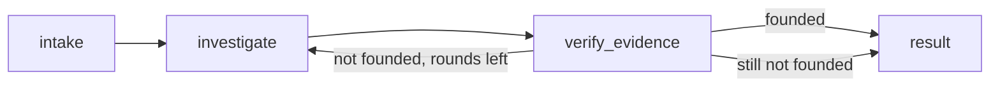

# Kubernetes Troubleshooting Agent

An AI agent that investigates a Kubernetes cluster, finds the root cause of an issue, and recommends the next action.

**Guiding principle: the cluster is the system under investigation; the agent and its tools run beside it,** so a diagnosis never depends on the health of the cluster it diagnoses. In the cluster: the test scenarios, the agent's identities, and one supporting service, the MLflow tracking server that stores the traces.

This repository contains the investigator agent (`agent investigate`), the failure scenarios it is tested against with a CLI to deploy and remove them, the agent's safe access to the cluster (two narrowly scoped identities and a read-only MCP server running beside the cluster), and MLflow tracing of every run. The design is in [SPEC.md](SPEC.md).

## Requirements

- A local Kubernetes cluster your kubeconfig points at. The examples use [kind](https://kind.sigs.k8s.io/). So far it has been tested on OrbStack only; kind, minikube and Docker Desktop are untested.
- [uv](https://docs.astral.sh/uv/) (it installs Python 3.14 if needed).
- [Helm 4](https://helm.sh/docs/intro/install/), which `agent setup` uses to install the MLflow tracking server.
- Docker with Compose and host networking. Host networking is built in on Linux and OrbStack. On Docker Desktop (4.34+) it's one setting: Settings → Resources → Network → Enable host networking.
- On native Linux Docker only: set `AGENT_CONTAINER_USER` in `.env` to your `id -u`:`id -g`, so the MCP container can read the credential file `agent setup` writes (mode 0600).
- An [Anthropic API key](https://console.anthropic.com/) for the agent, as `ANTHROPIC_API_KEY` in `.env` or your environment.

## Setup

```bash
kind create cluster --name k8s-agent    # or use any local cluster you already have
uv sync
cp .env.example .env                    # then set ANTHROPIC_API_KEY; override any other setting
uv run agent setup                      # the agent's identities and the tracking server (re-run to refresh tokens)
docker compose up -d --wait k8s-mcp     # the read-only MCP server
```

The CLI uses your own kubeconfig: `$KUBECONFIG` or `~/.kube/config`, with its current context (`kind create cluster` switches to `kind-k8s-agent`). To use another context, set `AGENT_KUBE_CONTEXT`. Every setting and its default is listed in `.env.example`.

## Investigating a problem

```bash
uv run agent scenario up selector
uv run agent investigate "The checkout service isn't reachable from other pods. Why?"
```

The agent finds the namespace itself; `-n <namespace>` points it at one. `--user NAME` records who asked (default: `AGENT_USER_ID`, else your OS user). `--quiet` turns off the progress, `--json` prints the result as JSON even in a terminal.

In a terminal you see the run as it happens: each node of the graph, the agent working in it (the investigator, then the critic), each tool call with what it returned, and the code checks, then a summary:

```
node     intake
node     investigate
  agent    investigator · claude-sonnet-5-5
    tool     namespaces_list()  E1 · 22 ms
             default, k8s-agent, kube-node-lease, kube-public, kube-system, shop-checkout  …
    tool     resources_list(Service -n shop-checkout)  E2 · 34 ms
             checkout  (1 row)
    tool     resources_list(EndpointSlice -n shop-checkout)  E4 · 34 ms
             checkout-jtrbb  (1 row)
    tool     pods_list_in_namespace(-n shop-checkout)  E3 · 35 ms
             checkout-69db948c9f-6wbw2, checkout-69db948c9f-cwwk4  (2 rows)
    tool     resources_get(Pod/checkout-69db948c9f-6wbw2 -n shop-checkout)  E5 · 21 ms
             Pod (162 lines of YAML)
    draft    fault_found · selector_mismatch · Service/checkout · cites E2 E3 E4 E5
node     verify_evidence
  check    code checks passed
  agent    critic · claude-sonnet-5-5
    ✓ E2  Service list shows checkout with SELECTOR app=check-out.
    ✓ E3  Both pods show 1/1 Running with labels app=checkout.
    ✓ E4  EndpointSlice checkout-jtrbb shows ENDPOINTS <unset>, i.e. no endpoints.
    ✓ E5  Pod YAML shows labels app=checkout and pod-template-hash, containerPort 80 named http, an…
    ✓ the proposed fix is backed by the evidence
  → founded
node     result

╭─ Fault found · selector_mismatch · Service/checkout in shop-checkout ────────────────────────────╮
│ The checkout Service's selector is app=check-out, but the checkout pods are labeled              │
│ app=checkout. The selector matches no pods, so the Service has no endpoints and nothing can      │
│ reach it.                                                                                        │
│                                                                                                  │
│ Ref  Finding                                       From                                          │
│ E2   Service checkout has selector app=check-out.  resources_list Service -n shop-checkout       │
│ E3   Both checkout pods are Running and Ready      pods_list_in_namespace -n shop-checkout       │
│      with label app=checkout.                                                                    │
│ E4   The EndpointSlice for checkout has no         resources_list EndpointSlice -n shop-checkout │
│      endpoints.                                                                                  │
│ E5   The pod's labels are app=checkout and         resources_get Pod/checkout-69db948c9f-6wbw2   │
│      pod-template-hash, with container port 80     -n shop-checkout                              │
│      named http, and the pod is Ready.                                                           │
│                                                                                                  │
│ Next step: Change the checkout Service selector from app=check-out to app=checkout.              │
│ Proposed fix: set the selector of Service shop-checkout/checkout to app=checkout. The pods carry │
│ the label app=checkout (E3, E5). Using that label in the selector lets the Service select both   │
│ pods and populate its endpoints. Nothing has been changed.                                       │
╰───────────────────────────── 13.4 s · 1 verify round · run f713649d ─────────────────────────────╯
```

The model's reasoning summaries (`thinking` lines) appear when it returns them; they are also what a trace shows of how the conclusion was reached. That is why the default effort is `high` (`AGENT_EFFORT`): at `medium`, Sonnet 5.5 rarely stops to think on these scenarios, so most runs show tool calls only, though they are faster and cost less.

Piped, or with `--json`, the result is JSON on stdout instead, for scripts (shortened here):

```json
{
  "run_id": "…", "thread_id": "…", "user_id": "alice", "trace_id": "tr-…", "status": "completed",
  "diagnosis": {
    "status": "fault_found",
    "fault_category": "selector_mismatch",
    "affected_resource": {"kind": "Service", "namespace": "shop-checkout", "name": "checkout"},
    "root_cause": "The checkout Service selects app=check-out, but the pods are labelled app=checkout…",
    "evidence": [{"ref": "E5", "finding": "The Service selector is app=check-out."}, …],
    "recommended_action": "Change the Service selector to app=checkout…",
    "proposed_fix": {"namespace": "shop-checkout", "service": "checkout",
                     "selector": [{"key": "app", "value": "checkout"}], "explanation": "…"}
  },
  "evidence_steps": [{"ref": "E5", "tool": "resources_get", "args": {…}, "error": false, "output_excerpt": "…"}, …],
  "verification": [{"round": 1, "founded": true, "problems": [], "findings": [{"ref": "E5", "supported": true, "reason": "…"}, …], "proposed_fix_backed": true, "feedback": null}]
}
```

- **`diagnosis.status`:** `fault_found` (root cause and affected resource), `no_fault` (nothing is wrong, with evidence that shows it), or `inconclusive` (it couldn't tell, and why).
- **`fault_category`:** the root cause, not the symptom, from a fixed list of 12, each defined in the [system prompt](src/k8s_agent/agent/prompt.md).
- **Evidence:** every finding cites an evidence ID such as `E5`. `evidence_steps` holds the tool call behind each cited ID, with an excerpt of its output.
- **`verification`:** each verify round: whether the evidence was founded, the code checks that failed, the critic's verdict on each finding and on the fix, and the feedback sent back.
- **`proposed_fix`:** filled only for a Service selector that doesn't match its pods, in a namespace where fixes are allowed (`AGENT_REMEDIATION_NAMESPACES`). Nothing acts on it yet: applying a fix, after a human approves it, comes in a later milestone.

How it works: an explicit [LangGraph](https://docs.langchain.com/oss/python/langgraph/overview) workflow.



- **investigate:** the investigator agent, LangChain `create_agent` with Claude Sonnet 5.5 and only the MCP server's 7 read tools (tools the server offers beyond those are never loaded). Its answer uses Claude's native structured output (`ProviderStrategy`). Every tool result is cleaned (`managedFields` removed), capped at 40,000 characters (a safety cap normal outputs never reach), and tagged with an evidence ID, unique across the run, before the model sees it.
- **verify_evidence:** first code checks what structured output can't: every cited ID exists, no empty findings, the answer is consistent (`no_fault` has category `none` and no resource; `fault_found` has a category and a resource; both cite evidence), and a fix only where one may be proposed. Then a separate critic agent, with no tools and [its own prompt](src/k8s_agent/agent/critic.md), reads the draft and only the tool outputs it cites, and judges each finding and the proposed fix. If the evidence doesn't hold up, the investigator gets the feedback and continues its own conversation, at most `AGENT_MAX_VERIFY_ROUNDS` (2) verifications per run; still unfounded, the answer is `inconclusive` with the reason.
- **Stopping rule:** in each investigate round, after 15 tool calls further calls are refused and the model concludes from what it has, and after 20 model calls the run stops. Across the whole run, the budget is 30 tool calls, 40 investigator model calls and 300 seconds. Each model call's output is capped at 8,000 tokens, so the tokens per run are bounded. Exhausting any of these gives `inconclusive`, keeping the steps gathered so far. A graph step limit (`AGENT_RECURSION_LIMIT`, 250) is a backstop the other limits always reach first. All are settings.

| What happened | Result | Exit code |
|---|---|---|
| A diagnosis the critic found founded | the summary in a terminal; the result JSON when piped or with `--json` | 0 |
| A limit or budget was hit, a model declined, its answer was invalid, or the evidence stayed unfounded | `inconclusive`, with the reason in `root_cause` | 0 |
| A model API error (bad key, rate limit, network) | `"status": "failed"`, with the reason in `error` | 1 |
| The MCP server can't be reached, or a setting is invalid | one error line on stderr; nothing ran | 2 |

When access to a namespace is refused, the progress line says so in yellow (`no access: can't list pods in namespace kube-system`) and the reason says the agent can read only namespaces that grant its reader a RoleBinding. If no namespace matches the service in the question, the agent says so (`inconclusive`) instead of trying the other namespaces one by one.

A failed tool call is retried with backoff (`AGENT_TOOL_MAX_RETRIES`, 2; first wait `AGENT_TOOL_RETRY_DELAY_SECONDS`, 1 s, doubling), then comes back to the model as a tool error with the server's own text. This covers timeouts and API errors that may pass on a second try. Errors a retry can't fix go back at once: access refused, an object or kind that doesn't exist, a missing argument. The MCP server gives no error code, so these are recognised by the Kubernetes API server's wording, which an M3 acceptance test checks against the real server; if a new server version rewords them, they are only retried, never misread. Retries don't count toward the tool-call budget.

Logs are JSON lines, each tagged with `run_id`, `thread_id` and `user_id`. At `INFO` (the default) they say when a run started and finished (duration, status) and every warning or failure with its reason; `AGENT_LOG_LEVEL=DEBUG` adds each tool call and verify round. They go to stderr when it isn't a terminal (containers, CI, a pipe), or to `AGENT_LOG_FILE` if set; an interactive terminal shows the progress view instead. The trace (next section) is the full record; the logs are the short fallback.

## Observability: MLflow traces

Every run is traced to an MLflow 3 tracking server that `agent setup` installs in the cluster with MLflow's official Helm chart and a minimal values file ([`deploy/mlflow-values.yaml`](deploy/mlflow-values.yaml)): one replica, SQLite on a 1 GiB volume so traces survive a restart, about 400 MiB of memory. The chart's built-in job runner is switched off: the evals score on the client, and with it the server needs 1.8 GiB. `agent setup` returns only once the server passes its readiness check. On OrbStack it's at http://localhost:5050 (not 5000, which macOS's AirPlay Receiver often holds). Clusters that give LoadBalancer Services no address (kind, minikube) need a port-forward for the same URL: `kubectl port-forward -n mlflow svc/mlflow-mlflow 5050`.

Tracing is on when `MLFLOW_TRACKING_URI` is set, as in `.env.example`. After each run the CLI prints the trace's link on stderr, and the result JSON carries its `trace_id`:

```
Trace: http://localhost:5050/#/experiments/3/traces?selectedEvaluationId=tr-ccfdf6fca46ec9a45e9920ac689258a7
```

What a trace shows, against the brief's list:

| The brief asks to see | Where it is in the trace |
|---|---|
| request → agent → model → tool calls → response | The root span `investigation` holds the question and the result JSON. Under it, each stage of the graph is a span (`intake`, `investigate`, `verify_evidence`, `result`), with the `investigator` agent and its model and tool calls inside `investigate`, and the `critic` inside `verify_evidence`. |
| What the agent did; which tools | One span per tool call, named after the tool, with its evidence ID (`E3`) in the span's metadata. |
| Tool inputs and outputs | Each tool span holds the arguments and the server's raw output; the `tools` step around it holds what the model saw (cleaned, capped and tagged). |
| Failures or errors | A refused or failed tool call is an error span with the server's message. A failed run marks the whole trace as an error. |
| Latency | Every span's duration; the trace's duration is the run's. |
| How the conclusion was reached | The model's reasoning summaries, in its model-call spans, and the critic's verdict in each verify round: every finding judged, with its reason. |

Each trace also records who asked and which conversation (MLflow's own user and session fields, which the UI filters by), the run ID, the model settings and the git commit, which pins the prompts too. MLflow adds the token counts and cost of each model call and of the run.

The tracing is MLflow's own: `mlflow.langchain.autolog()` traces the LangGraph run. The agent only adds the root span, names the graph run, and puts each call's evidence ID in the tool's metadata, which MLflow records.

Tracing never decides how a run ends:
- **The tracking server can't be reached when the run starts:** one warning, and the run goes on without tracing, after at most one 3-second check.
- **It stops during a run:** the spans that can't be sent are dropped, and the CLI still exits at once. Each call to the server is limited to 3 seconds (`MLFLOW_HTTP_REQUEST_TIMEOUT`) and not retried (`MLFLOW_HTTP_REQUEST_MAX_RETRIES=0`); MLflow's own defaults retry for about four minutes.

MLflow's usage telemetry to its own servers (`MLFLOW_DISABLE_TELEMETRY`) is off in the agent and in the tracking server.

## How the agent reaches the cluster

The agent never uses your credentials. It sees the cluster only through an MCP server that runs as a read-only identity, and the one fix it may ever apply uses a second identity that can only fix and verify a Service in one namespace.

### Identities (`agent setup`)

`agent setup` uses your admin kubeconfig to apply [`deploy/rbac.yaml`](deploy/rbac.yaml): namespace `k8s-agent`, two ServiceAccounts and their ClusterRoles. Each scenario's `namespace.yaml` binds them in its namespace.

| Identity | Can | Can't | Where |
|---|---|---|---|
| `reader` | Kubernetes' built-in `view` role: read pods, logs, events, Services, EndpointSlices, ConfigMaps, workloads (Deployments, StatefulSets, DaemonSets, Jobs), NetworkPolicies, ResourceQuotas, LimitRanges, ServiceAccounts, volume claims; list namespaces | read Secrets (credentials, incl. other ServiceAccounts' tokens), Roles or RoleBindings; change anything; exec into pods | each namespace with a `k8s-agent-reader` RoleBinding (the four `shop-*`); listing namespaces is cluster-wide |
| `remediator` | get and patch Services; get and list pods and EndpointSlices | delete anything, read Secrets or other types, act in other namespaces | only where a `k8s-agent-remediator` RoleBinding exists (`shop-checkout`) |

Each identity gets a short-lived token (`AGENT_TOKEN_TTL_HOURS`, 12 by default), checked with a "who am I" call and written to its own kubeconfig under `.kube-agent/` (gitignored, mode 0600). When the tokens expire, run `agent setup` again. It's safe to re-run, and a running MCP server picks up the new token without a restart.

Access is granted per namespace, never cluster-wide: ConfigMaps in other namespaces, such as `kube-system`, can hold sensitive data. To let the agent read another namespace, add a RoleBinding there (copy one from a scenario's `namespace.yaml`); to let it fix a Service there later, also add the namespace to `AGENT_REMEDIATION_NAMESPACES` and a `k8s-agent-remediator` RoleBinding. Deleting a namespace deletes its RoleBindings, and `agent scenario up` applies them again with the namespace.

Known limit: Kubernetes grants permissions per object type, so the remediator could change any field of a Service in `shop-checkout`. What keeps the fix narrow is the fix tool's code, a human approval and the short token lifetime.

### MCP server (`docker compose up -d k8s-mcp`)

The agent's only view of the cluster is the community [Kubernetes MCP server](https://github.com/containers/kubernetes-mcp-server) (`quay.io/containers/kubernetes_mcp_server`, release v0.1.2 pinned by digest), running as a container beside the cluster and configured by [`mcp/config.toml`](mcp/config.toml):

- **Read-only mode**, with exactly 7 tools: `namespaces_list`, `pods_list_in_namespace`, `pods_get`, `pods_log`, `events_list`, `resources_get`, `resources_list`. Tools that exec, run, delete or change anything don't exist on the server.
- **Secrets blocked** by the server (`denied_resources`), in addition to the reader's permissions.
- **The reader's kubeconfig only.** The remediator's credentials never enter this container.
- **Host networking**, so the kubeconfig's address (often `127.0.0.1:<port>`) works unchanged inside the container. It listens on `127.0.0.1:8080` only (`AGENT_MCP_PORT`), at `http://localhost:8080/mcp`, because the server has no login of its own.
- **Hardened:** a non-root user, all Linux capabilities dropped, no privilege escalation, and a health check.

## Failure scenarios

Four scenarios, each in its own namespace. Each is a folder in `scenarios/`: plain Kubernetes YAML in `manifests/` (its Namespace and the agent's RoleBindings in `namespace.yaml`, then the app, with public images pinned by digest), and a `scenario.yaml` with the question to ask, the accepted answers, and the condition that proves the fault is live.

Nothing the agent can see hints at the fault. Namespaces and labels look like a normal app (`shop-checkout`, ownership label `app.kubernetes.io/part-of=k8s-agent-demo`), and the folder name, which does describe the fault, never reaches the cluster (a unit test checks every name and label in the manifests).

| Folder | Namespace | What's broken | Question for the agent |
|---|---|---|---|
| `crashloop` | `shop-orders` | The ConfigMap key is misspelled (`DATABSE_URL`), so the app logs "DATABASE_URL not set", exits 1 and goes into CrashLoopBackOff. | The orders service keeps restarting. What's wrong? |
| `selector` | `shop-checkout` | The Service selects `app: check-out` but the pods are labelled `app: checkout`, so the Service has no endpoints while the pods are healthy. | The checkout service isn't reachable from other pods. Why? |
| `readiness` | `shop-catalog` | The readiness probe checks `/healthz`, which nginx answers with 404, so the pods run but never become Ready. | Why is the catalog service not serving traffic? |
| `healthy` | `shop-inventory` | Nothing (the control case). The right answer is "no fault". | Is the inventory service healthy? |

```bash
uv run agent scenario list               # the four scenarios and their namespaces
uv run agent scenario up selector        # recreate it with the agent's access, wait until the fault is live
kubectl get pods,endpointslices -n shop-checkout
uv run agent scenario down selector      # delete the namespace (and the RoleBindings) and wait until it's gone
```

`up` waits until the fault can be observed: the pods Ready, or Running but not Ready, and for `crashloop` until the pod has restarted twice (about 40 seconds). Running `up` again recreates the scenario from scratch. Both commands refuse to touch a namespace without the ownership label, such as your own `shop-orders`.

## Development

```bash
make check         # lint + unit tests (no cluster, Docker or network; never reads your .env)
make accept M=4    # milestone 4's acceptance tests, against your cluster, the real model and MLflow
make accept        # every milestone's acceptance tests (before committing a milestone)
```

The acceptance tests deploy and remove the scenarios themselves, and clean up even when a test fails. The M2 and M3 tests keep scenarios that are already up (ours, manifests re-applied cleanly, fault live) and leave them up afterwards, since no test changes them; this saves about a minute per run. `AGENT_ACCEPT_REUSE_SCENARIOS=false` gives fresh scenarios, removed afterwards (needed only if you delete an object from a manifest, which re-applying doesn't remove). The M2 and M3 tests also run `agent setup`, and start the `k8s-mcp` service if it isn't running (and stop it again afterwards). The M2 tests call the MCP server through `langchain[mcp]`, the client the agent uses. The M3 tests ask the real model each scenario's question without a namespace and check the diagnosis against the scenario's accepted answers (one retry, because model answers vary); each run costs a few cents of API usage. The M4 tests run `agent investigate` as a user would, read its trace back from the tracking server and check it against the brief's observability list line by line; they also restart and stop the tracking server (and bring it back with `agent setup`), and need `MLFLOW_TRACKING_URI`. Test runs trace to their own experiment, `k8s-agent-tests` (`AGENT_ACCEPT_MLFLOW_EXPERIMENT_NAME`), so `k8s-agent` shows real runs only. The unit tests use a scripted model, an in-process fake MCP server and a fake Kubernetes API, and never reach a cluster.

## Project layout

```
scenarios/<folder>/      manifests/*.yaml (namespace.yaml: the namespace and the agent's access) + scenario.yaml
deploy/rbac.yaml         the agent's identities: ServiceAccounts, ClusterRoles (applied by `agent setup`)
deploy/mlflow-values.yaml  the MLflow tracking server's Helm values (installed by `agent setup`)
src/k8s_agent/           CLI, scenarios, agent identities (access.py), settings (config.py),
                         tracing (tracing.py), the tracking server install (tracking_server.py)
src/k8s_agent/agent/     the agents: workflow (graph.py), investigator middleware, critic, prompts (*.md)
mcp/config.toml          MCP server configuration (read-only, tool allowlist, Secrets denied)
docker-compose.yml       the k8s-mcp service
tests/unit/              fast tests, no cluster
tests/acceptance/        tests against a real cluster
SPEC.md                  design and decisions
PLAN.md                  build plan
```
